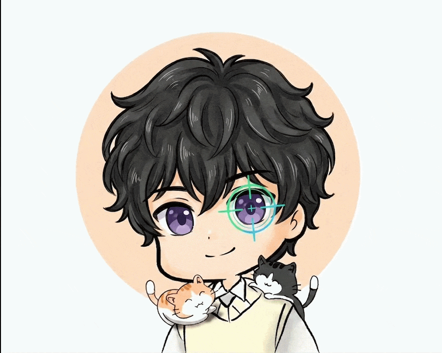

  <h1>👋 Nǐ hǎo, Wǒ shì Darunnaim Sindid</h1>

  <!-- Dynamic Typing Subtitle -->
  

    

  <!-- Profile GIF (Keep mp_gif.gif in your repository root) -->
  

    

  <!-- Profile Visitor Counter -->
  

| 🧭 Objective | 📋 Description & Details |
| :--- | :--- |
| 🔭 **Current Project** | Building **BookSwap** — A peer-to-peer book exchange platform on Android |
| 🌱 **Skill Tree** | Leveling up **Godot Engine**, **Unreal Engine 5**, **GDScript**, & Android |
| 💬 **Ask Me About** | Gaming & Esports, Game Dev Mechanics, C++/C#, Laravel, AI Prompts |
| 📫 **Summon Point** | [sindidas90@gmail.com](mailto:sindidas90@gmail.com) • [dquadofficialgg@gmail.com](mailto:dquadofficialgg@gmail.com) |
| ⚡ **Passive Trait** | **Felid Affinity:** Cats deal 100% emotional critical damage 🐈 |

<h3 align="center">🎮 Gaming Lineup</h3>

  
  &nbsp;
  
  &nbsp;
  
  &nbsp;
  
  &nbsp;
  

---

<h3 align="center">🤖 AI</h3>

  
  &nbsp;
  

---

<h3 align="center">🛠️ Tech Arsenal</h3>

  <!-- Game Dev & 3D -->
  
<b>🕹️ Game Development & 3D Modeling</b>

  
    

  <!-- Mobile Development -->
  
<b>📱 Mobile Development</b>

  
    

  <!-- Core Languages -->
  
<b>💻 Core Languages</b>

  
    
  
    

  <!-- Web & Backend -->
  
<b>🌐 Web, Backend & Cloud</b>

  
    

  <!-- Tools & Productivity -->
  
<b>🎨 Tools & Productivity</b>

  
    
  
  &nbsp;
  
  &nbsp;
  

---

<h3 align="center">📊 GitHub Analytics</h3>

  
  

 

  

 

  

---

<h3 align="center">🌐 Connect With Me</h3>

  
  
  
  
  
  

